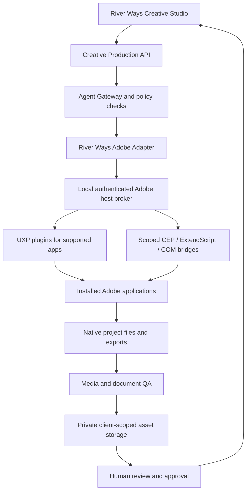

# River Ways — Adobe Ecosystem Integration Register

**Status:** Research verified; no Adobe connector installed or enabled  
**Reviewed:** 23 November 2026  
**Target:** River Ways Creative Studio and authorised local production workers  
**Primary workstation context:** Windows desktop; exact Adobe applications, versions and licences remain unverified.

## 1. Decision

Treat Adobe Creative Cloud as a professional production ecosystem that River Ways can control through supported application extensions and carefully scoped local adapters.

Do not treat one community MCP server as a complete or official Adobe integration. Do not install multiple overlapping Adobe MCP servers. Build one River Ways Adobe adapter boundary and select product-specific bridges behind it.

**Preferred integration order:**
1. Adobe UXP and official application APIs where supported.
2. Official Adobe sample projects and SDKs for implementation patterns.
3. A narrowly scoped community MCP or SDK after source, security, compatibility and licence review.
4. CEP / ExtendScript / COM only where the required application capability has no suitable current UXP route.
5. Desktop UI automation only as a last resort, with visible execution and explicit approval.

The official Adobe developer-resource index contains community contributions and explicitly says that listing a project is not an Adobe endorsement.

## 2. Verified discovery sources

### 2.1 Official Adobe platform

| Resource | Source | Decision |
|---|---|---|
| UXP developer platform | https://developer.adobe.com/uxp/ | Primary extension-development reference |
| Adobe developer portal | https://developer.adobe.com/ | Source for supported APIs, SDKs and app-specific documentation |
| UXP Premiere Pro samples | https://github.com/AdobeDocs/uxp-premiere-pro-samples | Official sample repository; use as a Premiere implementation reference |
| Creative Cloud community index | https://github.com/AdobeDeveloperCommunity/creative-cloud-developer-resources | Discovery index only; verify each linked project independently |

The Premiere samples repository documents UXP panels and examples for project/sequence inspection, markers, metadata, effects, transitions, keyframes, import/export, transcripts and project conversion. Its README identifies Premiere Pro 25.2+ and UXP Developer Tool 2.2+ as prerequisites for its documented setup. Check each sample manifest before use.

### 2.2 Community integration candidates

| Repository | What its README claims | Verified constraints | River Ways decision |
|---|---|---|---|
| [dcc-mcp/adobepy](https://github.com/dcc-mcp/adobepy) | Shared Python SDK and Rust broker with UXP/CEP bridges for Photoshop, Illustrator, InDesign, Premiere and After Effects | README describes a local broker, per-session token, capability gates and typed host identity. A root `LICENSE` file was not found at the checked path. Platform and licence status need further inspection. | **High-priority technical evaluation.** Do not install until licence, platform, release and security review pass. |
| [cavi-ai/adobe-mcp](https://github.com/cavi-ai/adobe-mcp) | Application-specific MCP servers for Photoshop, Illustrator, Animate and Dimension, with associated products for After Effects, Premiere and Substance | Repository README states MIT; macOS, Python 3.15+, `uv`, licensed Adobe apps and local automation permissions are required. | **Do not select for the current Windows workstation.** Revisit only if a supported macOS worker is available. |
| [Jonohobs/adobe-mcp](https://github.com/Jonohobs/adobe-mcp) | Windows MCP automation for Photoshop, Illustrator, Premiere Pro, After Effects, InDesign, Animate, Character Animator and Media Encoder | README states Windows 10/11, Python 3.10+ and COM/ExtendScript-based automation; root licence is MIT. App/version claims and operation safety still need source review. | **Windows pilot candidate.** Audit tool definitions, arbitrary command paths, file access, process selection and write/destructive actions before enabling. |
| [AdobeDocs/uxp-premiere-pro-samples](https://github.com/AdobeDocs/uxp-premiere-pro-samples) | Official Premiere Pro UXP plugin examples | AdobeDocs-owned sample repository; app and UXP versions are specified in manifests and README. | **Adopt as a reference**, not as a production service. |

### 2.3 Additional candidates from Adobe's community index

The index currently lists the following projects. Their presence in the index is discovery evidence only. River Ways has not completed source, licence, security or compatibility audits for them.

| Candidate | Claimed application scope | Next action |
|---|---|---|
| [after-effects-mcp by JUNKDOGE-JOE](https://github.com/JUNKDOGE-JOE/after-effects-mcp) | After Effects project, animation and preview workflows | Verify repository activity, licence, host protocol and supported AE versions |
| [lightroom-mcp by Automaat](https://github.com/Automaat/lightroom-mcp) | Lightroom Classic photos, metadata, collections and develop settings | Verify local catalogue access, read/write scopes and backup safety |
| [after-effects-mcp by Dakkshin](https://github.com/Dakkshin/after-effects-mcp) | After Effects compositions, layers and animations through ExtendScript | Compare with the other AE candidate; do not install both by default |
| [adb-mcp by mikechambers](https://github.com/mikechambers/adb-mcp) | Photoshop and Premiere automation | Verify compatibility, licence, supported operations and current maintenance |

## 3. Adobe application map for River Ways

| Adobe application | River Ways production use | Integration route |
|---|---|---|
| Photoshop | Campaign artwork, image retouching, compositing, thumbnails, product imagery | UXP where supported; otherwise reviewed native scripting bridge |
| Illustrator | Brand graphics, vector artwork, diagrams, icons and illustrations | UXP or application scripting after version check |
| Premiere Pro | Commercials, brand films, interviews, social edits and final timeline work | Official Premiere UXP APIs and samples |
| After Effects | Motion graphics, kinetic typography, compositing, title sequences and VFX | UXP where supported; reviewed scripting bridge for remaining gaps |
| InDesign | Proposals, reports, brochures, catalogues and editorial layouts | UXP / InDesign scripting after version check |
| Lightroom Classic | Photo selection, metadata, batch photo treatment and collections | Local catalogue-aware adapter with backup and write-scope controls |
| Audition | Voiceover, sound cleanup, podcast editing and audio finishing | Application-specific scripting or controlled project handoff |
| Media Encoder | Batch encoding and delivery presets | Supported application scripting and render-queue handoff |
| Acrobat | PDF generation, review and document preparation | Document APIs or controlled file workflow; do not automate signatures without explicit approval |
| Substance 3D | Materials, texture and product visualisation | App-specific SDK/API review |
| Adobe Express | Fast template-led social content | Official API and account entitlements review; no assumed free automation |

Application support differs by product and release. Never assume that every Adobe application exposes the same UXP APIs or automation surface.

## 4. Target architecture

The Adobe host broker must run on a River Ways-controlled workstation or private worker. Do not run desktop Adobe applications, COM automation or GPU workloads inside Cloudflare Pages Functions.

### Adapter responsibilities

The River Ways Adobe Adapter must:
- detect installed Adobe applications and exact versions;
- report available capabilities for each app/version;
- establish a local authenticated session with the intended application instance;
- expose a narrow, typed operation catalogue;
- validate project paths against the assigned client/project workspace;
- require explicit operation scopes;
- use safe working copies for destructive edits;
- record input hashes, output hashes, app version, operation, actor and result;
- apply timeouts and detect unknown outcomes;
- preserve native editable project files;
- return output paths and QA evidence to the production job;
- refuse operations that exceed the granted scope.

An MCP server can expose the adapter's operations to agents. MCP does not provide tenant isolation, application identity or permission enforcement by itself.

## 5. Operation and approval classes

| Class | Example | Default policy |
|---|---|---|
| Read-only inspection | List layers, inspect sequences, read metadata | Allow only within the assigned project workspace |
| Reversible edit | Add a layer, update text, adjust a copy | Work on a copy; record operation and output |
| Destructive edit | Delete layers, overwrite source, alter original project | Deny by default; require explicit human approval and backup |
| Export | Export PNG, PDF, audio or video | Require approved destination path and format limits |
| External action | Upload, share, publish, send or purchase | Require explicit approval for the exact destination and content |
| Paid AI feature | Generative credits or metered service | Disabled unless owner approves the cost and account entitlement |

Do not allow agents to purchase Creative Cloud plans, consume paid generative credits, accept licence terms, publish to public channels or overwrite original project files without explicit approval.

## 6. Security and privacy gates

Before enabling any Adobe connector:
1. Review all tool definitions and every subprocess or script execution path.
2. Reject arbitrary shell, PowerShell, Python, JSX or filesystem commands from untrusted agent input.
3. Bind the adapter to a specific application instance and verify the application identity.
4. Restrict all file operations to an assigned client/project root.
5. Use an explicit allowlist of operation names and argument schemas.
6. Keep MCP credentials and broker tokens in local secret storage.
7. Log operation metadata without recording client secrets or unnecessary creative content.
8. Require a backup or working copy before destructive edits.
9. Add negative tests for path traversal, wrong application identity, expired sessions, cross-client access and unsupported versions.
10. Verify the Adobe account is licensed for the application and features used.

Adobe project files can contain confidential client work. Treat them as private client data.

## 7. Licensing and cost

- Adobe desktop applications require the relevant Adobe licence or subscription. The open-source status of an MCP repository does not make Adobe applications free.
- Adobe APIs and SDKs have their own terms and supported-use requirements.
- Community MCP server licences apply to the server code, not to Adobe applications, fonts, stock assets, model outputs or client media.
- The Cavi repository declares MIT. The Jonohobs repository declares MIT. The checked adobepy root did not expose a `LICENSE` file at the expected path; treat its licence as unresolved until the repository's exact licence terms are confirmed.
- Adobe generative features can consume account credits. Keep them disabled unless the owner approves the spend and usage.
- Check font, stock, music, template and plugin licences separately.

No paid Adobe service, subscription, generative credit or additional hosting cost is authorised by this register.

## 8. Recommended implementation sequence

### Phase A — Workstation inventory
Record Windows version, installed Adobe products, exact versions, account entitlement, Python/Node versions and local project storage. Do not install a connector before this inventory.

### Phase B — Source audit
Review adobepy and Jonohobs/adobe-mcp. Compare their supported applications, tool schemas, local execution model, permissions, licences, releases and tests. Exclude macOS-only Cavi from the Windows pilot.

### Phase C — One application proof
Select Photoshop or Premiere Pro based on the first real production task. Build one read-only inspection operation, one safe copy-based edit and one export. Verify exact application identity, project containment, audit and rollback.

### Phase D — River Ways adapter
Wrap the selected bridge behind a stable adapter contract. Do not couple Creative Studio UI directly to a community MCP protocol.

### Phase E — Expand by application
Add Illustrator, After Effects, InDesign, Lightroom, Audition and Media Encoder only when a real workflow needs them and each application passes its own version and permission tests.

### Phase F — Production acceptance
Run a complete client-authorised task with native source file, export, hashes, QA evidence, human approval and a documented recovery path.

## 9. Acceptance criteria

- The adapter detects the exact Adobe application and version.
- The adapter rejects an unexpected application instance.
- The adapter rejects paths outside the assigned project workspace.
- Agents cannot call operations outside their explicit capability grant.
- Destructive operations preserve a recoverable source copy and require approval.
- All outputs have provenance and hashes.
- No credential or private client asset appears in logs or public storage.
- A real native project can be reopened and edited in the target Adobe application.
- Export output passes media/document QA.
- The connector has a verified licence, supported app version and documented cost profile.

## 10. Current status

- Official Adobe developer resources and the community resource index have been located.
- Five named repositories have been verified as existing GitHub repositories.
- The Premiere UXP samples and the three community MCP/SDK README files have been inspected.
- Cavi's README and MIT licence were inspected; it requires macOS and is not the current Windows candidate.
- Jonohobs' README and MIT licence were inspected; Windows support is claimed but not independently tested.
- adobepy README was inspected; its root `LICENSE` path was not found. Licence and platform compatibility remain open.
- No Adobe software inventory was performed on the user's workstation.
- No Adobe connector has been installed, configured or executed.
- No Adobe project has been opened or modified.
- No client data has been sent to an Adobe integration.

## 11. Upstream references

- Adobe UXP: https://developer.adobe.com/uxp/
- Adobe developer portal: https://developer.adobe.com/
- Adobe community resource index: https://github.com/AdobeDeveloperCommunity/creative-cloud-developer-resources
- Premiere UXP samples: https://github.com/AdobeDocs/uxp-premiere-pro-samples
- adobepy: https://github.com/dcc-mcp/adobepy
- Cavi Adobe MCP: https://github.com/cavi-ai/adobe-mcp
- Jonohobs Adobe MCP: https://github.com/Jonohobs/adobe-mcp
