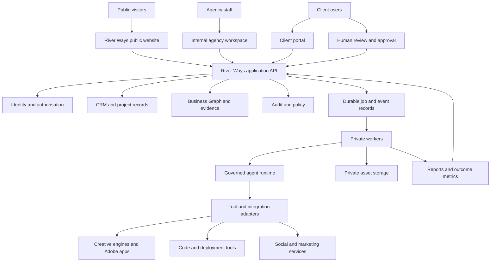

# River Ways — Ecosystem Master Architecture

**Status:** Target architecture and implementation reconciliation  
**Revision:** 1.0 · 23 November 2026  
**Repository baseline:** `godsbest656-glitch/river-ways`  
**Working base:** `feat/river-ways-creative-studio-foundation` at `5edb5e0932788e715a0d65a0fb6544c2b34671da`  
**Purpose:** Define one coherent agency ecosystem without duplicating existing products, runtimes, databases or integrations.

## 1. Executive decision

River Ways is an AI-native Creative Demand Engineering agency. Its ecosystem must connect business understanding, acquisition, delivery, creative production, engineering, client collaboration and measurable outcomes.

The public website is one surface of the business. It is not the operating system.

Build one shared operating foundation and expose specialist capabilities through coherent workspaces. Do not create one independent application, database, agent runtime or dashboard for every department.

**Operating principle:** River Ways owns business workflows. Specialist applications perform specialist work. Governed agents coordinate work. Humans approve consequential decisions. The platform records evidence and measures outcomes.

## 2. Product and organisational boundaries

Keep these four boundaries explicit:

1. **River Ways public experience:** public website, services, enquiry, public-safe work catalogue and discoverability.
2. **River Ways internal operating platform:** staff workspace, CRM, projects, AI workforce, finance records, knowledge, creative production and reporting.
3. **Client workspaces:** tenant-isolated briefs, projects, assets, reviews, approvals, reports and deliverables.
4. **Separate client products and businesses:** Avenize and other client-owned products keep their own identities, data, credentials, access policies and roadmaps.

Shared code or infrastructure does not grant shared data access. Avenize remains a separate business/product. River Ways may provide its marketing, engineering and creative services through an explicitly authorised client workspace. Do not merge Avenize's internal CRM, HR, Business Graph or product operations into River Ways.

Rebuilder / Revenue OS remains a separate acquisition-intelligence workstream. It can provide qualified, evidence-backed opportunity records to River Ways CRM through a defined integration. It is not the CRM system of record.

## 3. Business ecosystem

### 3.1 Core capabilities

| Domain | Responsibility | Primary records |
|---|---|---|
| Agency Experience | Public brand, services, work catalogue and enquiry | Pages, published work, enquiries |
| Business Intelligence | Business discovery, market research, customer and competitor evidence | Research, observations, sources, hypotheses |
| Growth & Acquisition | Prospect discovery, intent, outreach, campaigns and conversion | Prospects, opportunities, campaigns, touchpoints |
| Client Operations | Qualification, onboarding, scope, projects, communication and delivery | Clients, contacts, briefs, projects, deliverables |
| AI Workforce | Agent identity, skills, assignments, execution, limits and evaluations | Agents, capabilities, tasks, runs, evaluations |
| Creative Studio | Design, image, video, motion, 3D, audio and publishing assets | Creative projects, briefs, scenes, assets, renders |
| Engineering Studio | Websites, applications, integrations and custom AI systems | Repositories, environments, deployments, tests |
| Business Operations | Finance, people, administration and procurement | Quotes, invoices, payment evidence, expenses, people |
| Knowledge & Data | Business Graph, documents, provenance, search and reporting | Entities, relationships, evidence, metrics |
| Reliability & Governance | Identity, authorisation, audit, security, policy and quality | Roles, grants, audit events, controls, incidents |

These are business capabilities. They do not require ten separate applications or ten separate services.

### 3.2 Application surfaces

| Surface | Audience | Responsibility |
|---|---|---|
| River Ways Website | Public | Brand, services, proof, insights and enquiry |
| Control Tower | Founder / leadership | Agency-wide status, risks, decisions and outcomes |
| Staff HQ | Internal staff | AI workforce, departments, tasks and approvals |
| Intelligence Hub | Strategists and researchers | Business research, market signals and evidence |
| Growth HQ | Growth team | Prospects, campaigns, outreach and conversion |
| CRM & Client Operations | Account and project teams | Client lifecycle, pipeline, projects and delivery |
| Creative Studio | Creative team | Briefs, direction, production, asset review and exports |
| Engineering Studio | Engineering team | Software projects, code, tests, environments and releases |
| Social Media Manager | Growth team and authorised clients | Social accounts, content, calendars, publishing and analytics |
| Client Portal | Client users | Briefs, progress, review, approval and deliverables |
| Knowledge Hub | Authorised staff | Searchable, permission-aware institutional knowledge |
| Admin & Governance | Administrators | Users, roles, integrations, policies and audit |

The surfaces should share navigation, design tokens, identity and permission contracts. A module can begin as a route or section inside an existing application. Split it into a separately deployed service only when runtime, security, scaling or licensing requires that boundary.

## 4. System context

This is a target logical architecture. It does not mean every box is deployed.

## 5. Shared platform foundations

### 5.1 Identity and access

- Use authenticated identities for staff, clients, service workers and integrations.
- Enforce authorisation on the server for every protected read and write.
- Separate agency roles from client roles.
- Scope every client-owned record to an organisation/workspace.
- Treat service tokens as service identity, not as human identity.
- Use least privilege and explicit grants for external accounts and tools.
- Record actor, action, target, time, outcome and relevant evidence for consequential operations.
- Do not add public signup to internal systems without a reviewed onboarding and abuse model.

### 5.2 Organisation and tenant model

The platform must distinguish the River Ways agency organisation, client organisations, projects and authorised workspaces. A client must not read another client's briefs, assets, channels, jobs, approvals or reports. Avenize is a separate client/business boundary.

Do not assume that a client identifier supplied by the browser establishes authority. Derive the authorised workspace from the authenticated actor and server-side grants.

### 5.3 Business Graph and evidence

Represent people, organisations, prospects, clients, objectives, projects, campaigns, products, systems, agents, tasks, assets, decisions and outcomes as linked records.

Every material assertion should have a type:
- verified fact;
- source-backed observation;
- client-supplied statement;
- estimate;
- hypothesis;
- decision;
- unknown or unavailable.

Store source, retrieval date, reporting period, timezone, owner and confidence where applicable. Agents must not convert an estimate or hypothesis into a verified fact.

### 5.4 Workflow and job execution

Use explicit job states, dependencies, leases, bounded retries, idempotency, cancellation and failure recovery. A successful tool call is not automatically an approved deliverable.

The existing Creative Studio API has D1-backed client/project/job records, worker claim and lease logic, private asset routes and immutable agency approval events in the inspected branch. The worker code currently supports `project_init`, `strategy` and `copy`; strategy and copy are deterministic brief-to-document transforms, not AI inference. Confirm these exact handlers and tests before expanding the allowlist.

Do not introduce Temporal, NATS, a second agent runtime or a second queue until a documented requirement proves the existing application-owned job model is insufficient.

### 5.5 Asset and document management

- Store metadata and audit records in the operational database.
- Store media bytes in private object storage or approved local production storage.
- Keep source files, generated drafts, QA-passed assets, internally approved assets, client-approved assets and delivered assets distinct.
- Record SHA-256, media type, size, source, model/tool version, rights status, project, client, owner and revision.
- Never use a public object URL as a substitute for access control.
- Apply retention and deletion rules to client assets.

### 5.6 Integration adapter contract

The machine-readable candidate register is stored in `integrations/registry.json`. Validate it with `npm run validate:integrations`; the validator and regression tests are stored in `scripts/validate-integration-registry.mjs` and `tests/platform/integration-registry.test.js`. Registry entries describe candidate status and controls. They do not activate a connector or store credentials.

Every integration must declare:
- owner and business purpose;
- upstream repository/service and exact version or commit;
- supported operations and application versions;
- authentication method and required scopes;
- data read and data written;
- client/tenant isolation behaviour;
- licensing and commercial-use conditions;
- infrastructure, compute and ongoing cost;
- timeout, retry, idempotency and cancellation behaviour;
- logging, redaction and audit events;
- tests, failure modes, rollback and decommission path.

An MCP server is a tool interface, not an authorisation system. Place it behind the River Ways Agent Gateway or an equivalent policy boundary. Do not expose arbitrary filesystem, shell, browser or desktop-control access to every agent.

## 6. Current implementation baseline — observed on the working base

The following statements describe source code and documents observed on `feat/river-ways-creative-studio-foundation`. They do not establish production deployment.

| Capability | Observed state | Qualification |
|---|---|---|
| Public website | React 18 + Vite 6 codebase | Current production source and deployment must be verified separately |
| Public enquiries | Pages Function and D1 migrations | Remote D1 and Resend behaviour require environment verification |
| Creative Studio UI | Internal `/studio/` workspace exists | No client-facing reviewer portal |
| Studio API | D1-backed client, project and job endpoints | Preview Access/D1 configuration not verified |
| Authentication | Cloudflare Access JWT verifier and staff allowlist in code | Access applications and policies are not configured by this branch alone |
| Worker identity | Separate worker audience in code | Live service-token connection not verified |
| Creative asset storage | Private R2 upload and streaming code exists | R2 bucket and binding are not provisioned in the inspected status |
| Local worker | Worker daemon exists | Live workstation-to-Preview connection not verified |
| Worker job types | `project_init`, `strategy`, `copy` | Strategy/copy are deterministic drafts; concept/storyboard/image/video/render/QA/delivery are not enabled |
| Creative generation | Local ComfyUI adapter and approval gates exist | No live ComfyUI inference verified |
| Rendering | HyperFrames and optional Remotion adapters exist | No real render verified in the current status |
| Social publishing | Postiz integration architecture exists on a separate branch | No deployed Postiz service, connected channels or publishing UI verified here |
| Adobe integration | No Adobe adapter verified in this branch | Research and adapter design only |
| AI provider runtime | Not established by this branch audit | Reconcile the exact provider-backed runtime branch before connecting production agents |

### Documentation conflict to resolve

`docs/creative-studio/ACCESS_AND_OPERATIONS.md` says the worker currently claims only `project_init`. The inspected worker source and Studio API allowlist include `project_init`, `strategy` and `copy`. The source and tests are the implementation evidence. Update the stale operations document in the next Creative Studio documentation pass.

### Deployment boundary

The public website runs as a static React/Vite experience with Cloudflare Pages Functions. GPU inference, Adobe desktop applications and local video rendering must run on an authorised workstation or private worker host. Do not run long-lived rendering or GPU workloads inside public Pages request handlers.

## 7. Creative and media production ecosystem

Creative Studio is the coordinating product surface. It can use different specialist engines through adapters.

| Discipline | Preferred candidates | Intended use |
|---|---|---|
| Reference intelligence | Rea-Video and curated reference/prompt libraries | Analyse shot structure, pacing and visual language |
| Image generation | ComfyUI and approved local models | Generate and transform visual assets |
| Raster design | Adobe Photoshop; open tools where appropriate | Retouching, compositing and campaign graphics |
| Vector and identity | Adobe Illustrator; SVG tooling | Logos, vector artwork, icons and diagrams |
| Video composition | HyperFrames first; Remotion only after licence and cost review | Template-based video and motion compositions |
| Professional editing | Adobe Premiere Pro | Timeline editing, finishing and review |
| Motion graphics | Adobe After Effects, GSAP and approved effect libraries | Titles, motion systems, compositing and effects |
| 3D | Blender, Three.js and Substance 3D | Product scenes, environments and interactive experiences |
| Audio | Adobe Audition and approved audio tools | Voice, cleanup, sound design and mix |
| Publishing documents | InDesign, Acrobat and Express | Reports, decks, brochures and social adaptations |
| Media processing | FFmpeg / ffprobe | Transcoding, packaging and technical validation |

Do not install all tools by default. Select an engine per deliverable, hardware, license, rights, performance and cost. Maintain editable source files where the engagement includes them.

## 8. Growth, acquisition and social media

Growth & Acquisition owns the pipeline from opportunity discovery to measurable demand.

Capabilities:
1. Market and account research.
2. Lead discovery with source evidence.
3. Intent signals and qualification.
4. CRM records and pipeline stages.
5. Consent-aware, lawful outreach and opt-out handling.
6. Campaign and content strategy.
7. Creative asset production.
8. Social account connections and publishing.
9. Analytics imports and metric definitions.
10. Conversion and revenue reporting.

Postiz is a candidate publishing engine, not the CRM or campaign source of truth. The existing Postiz design correctly requires server-side API access, separate deployment, explicit content approval, channel grants, tenant isolation and audit. Its upstream AGPL-3.0 licence requires a specific commercial and network-use review.

Use official platform APIs and OAuth. Do not collect social passwords or scrape private account data. When free API access is unavailable, support client-authorised exports and manual import. Do not promise zero cost where platform or infrastructure limits do not permit it.

## 9. Engineering and deployment ecosystem

Engineering Studio should manage:
- discovery and technical requirements;
- design systems and component contracts;
- repositories and source provenance;
- implementation tasks and code review;
- unit, integration, browser, accessibility and performance tests;
- environments, previews and deployment evidence;
- security and dependency review;
- handover, maintenance and support.

Preserve the existing React/Vite, Cloudflare Pages and D1 baseline where it is fit. Use separate runtimes only for capabilities that need them, such as persistent workers, Adobe desktop automation or GPU rendering. Keep production releases behind existing approval gates.

## 10. Client lifecycle

Payment status must come from an authorised record or provider confirmation. A client message is not proof of payment. A draft is not an approved brief. A generated file is not a delivered asset. A deployment is not a measured business outcome.

## 11. AI workforce model

Each agent must have:
- stable identity and department;
- one accountable role and clear scope;
- input/output contracts;
- allowed tools and resource limits;
- data access boundaries;
- escalation conditions;
- human approval gates;
- evaluations and performance evidence.

Use the execution runtime already verified in the active platform branch. Do not assume a branch's Codex agent TOML files are deployed production agents. Paperclip may be evaluated for workforce management. AG-UI may be evaluated for interactive event streaming. Neither should replace the existing runtime or become an independent authority for permissions.

## 12. Security, privacy and governance

- Deny access by default.
- Authorise every request server-side.
- Enforce client and workspace isolation in database queries and foreign keys.
- Store secrets only in approved secret stores.
- Keep external service credentials out of browser code, Git and logs.
- Require rights and provenance checks for creative assets and models.
- Do not train or fine-tune on client data without explicit written permission.
- Require human approval for spend, public publication, production deployment, client commitments and final delivery.
- Record audit events for identity changes, grants, tool actions, approvals, publishing and deletion.
- Provide export, retention and deletion procedures.
- Separate verified metrics from estimates and hypotheses.

## 13. Cost and licensing policy

The platform PRD sets a zero-additional-cost constraint. Treat it as a default decision rule:
- prefer existing account capacity and local processing;
- verify free-tier limits and usage caps;
- do not assume free software means free compute;
- do not enable paid APIs, cloud rendering, subscriptions, paid models, stock assets or silent fallbacks;
- verify application licences and model-weight licences separately from repository code licences;
- record the commercial licence and territory for every client-facing asset.

A new cost requires explicit owner approval and a documented alternative analysis.

## 14. Implementation sequence

| Stage | Scope | Exit evidence |
|---|---|---|
| 0. Reconciliation | Select the correct integration base and reconcile branch divergence | Exact commit map, open PR map, source-of-truth register |
| 1. Shared foundation | Identity, roles, tenant grants, audit, domain contracts | Negative authorisation and tenant-isolation tests |
| 2. Operating workflows | CRM, clients, projects, tasks, reporting | Prospect-to-client-to-project journey with evidence |
| 3. Creative Studio hardening | Preview Access, D1, R2, worker connection and job contracts | End-to-end non-production worker test |
| 4. Creative production | Concept/storyboard adapters, ComfyUI, renderer and QA | Reproducible approved sample video with source and QA |
| 5. Adobe integration | Select UXP/native adapter and one application pilot | Supported operation, security review, app-version matrix and rollback |
| 6. Growth/social | Postiz or official platform adapter, content calendar and approvals | Tenant-isolated draft/review/schedule test; publishing still gated |
| 7. Client portal | Client identity, reviewer roles, comments and approval | Cross-tenant negative tests and exact-version approvals |
| 8. Business intelligence | Business Graph, reports and outcomes | Source-backed reports with metric definitions |
| 9. Optimisation | Agent evaluations, workflow reliability and cost | Baselines and measured improvements |

Do not start all stages in parallel. Complete shared identity, tenant and audit controls before exposing additional client-facing surfaces.

## 15. Acceptance criteria for the ecosystem

- One organisation/workspace model governs all private agency and client surfaces.
- Every user, agent, worker and integration has an explicit identity and permission scope.
- No client can access another client's records or assets.
- Every long-running task has a durable state and recovery path.
- Every creative asset has provenance, version and rights status.
- Every approval binds to an exact version and usage scope.
- Every published or delivered item has explicit authorisation.
- Every report identifies its sources, period, definitions and limitations.
- The public website does not expose internal workspace data.
- Avenize and other client products remain separate.
- No new paid service is enabled without owner approval.
- CI, Preview, deployment and production evidence are recorded separately.

## 16. Known blockers and owner decisions

1. Reconcile the creative-studio foundation branch with the newer GodMode and website integration work before application-code integration.
2. Verify the current provider-backed agent runtime branch and its exact commit.
3. Confirm workstation OS, GPU/VRAM, RAM, disk, installed Adobe applications and licences before enabling local creative engines.
4. Configure a dedicated non-production Access application, D1 database and private R2 bucket before live Studio testing.
5. Select the first Adobe integration after source audit and exact application/version testing.
6. Decide the identity provider and client authentication model before exposing client workspaces.
7. Verify Postiz deployment and provider account access before enabling publishing.
8. Confirm the zero-cost operating envelope and any exceptions.

Unknown information is a blocker or assumption. Do not fill it with a guess.

## 17. Source-of-truth references

- `AGENTS.md` — repository rules and release controls.
- `docs/platform/PRD.md` — product requirements and zero-cost constraint.
- `docs/platform/architecture.md` — platform architecture proposal.
- `docs/platform/rules.md` — binding platform rules.
- `docs/platform/ENGINEERING_RESOURCE_REGISTRY.md` — existing technology evaluation.
- `docs/creative-studio/IMPLEMENTATION_STATUS.md` — Studio implementation evidence and gaps.
- `docs/creative-studio/ACCESS_AND_OPERATIONS.md` — Studio API and deployment boundary; one worker-capability statement requires reconciliation.
- `creative-production/README.md` and `AGENT_WORKFLOW.md` — local creative engine and production gates.
- `docs/integrations/ADOBE_ECOSYSTEM_REGISTER.md` — Adobe source and adapter review.
- `docs/platform/INTEGRATION_ADOPTION_REGISTER.md` — cross-ecosystem adoption decisions.
