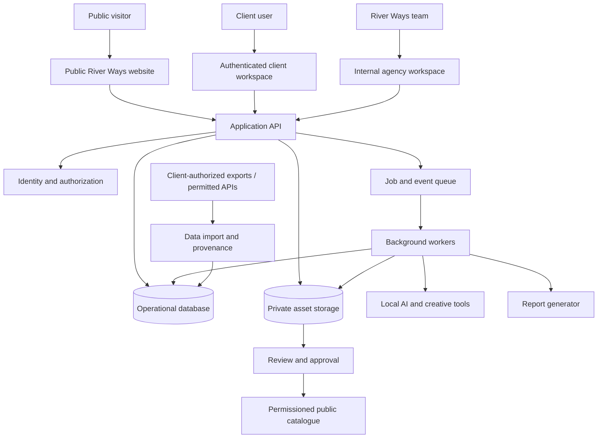

# River Ways Agency Operating Platform — Architecture

**Status:** Target architecture proposal; implementation state must be verified per environment  
**Version:** 1.0 · 2 November 2026

## 1. Architecture goals

Build one coherent operating platform around the River Ways public website while keeping public content, private agency operations and client data safely separated. Reuse the existing React 18 + Vite 6 and Cloudflare-oriented foundation where verified. Avoid a rewrite, paid infrastructure dependencies and premature microservices.

The architecture must support:
- public marketing and a curated creative catalogue;
- internal CRM, projects, tasks, creative production and reporting;
- client-isolated workspaces and approvals;
- local-first AI and batch media production;
- evidence provenance and auditability;
- export, backup, recovery and eventual portability.

## 2. System context

This is a logical view. It does not assert that all services or integrations are already deployed.

## 3. Deployment and technology strategy

### 3.1 Existing application baseline
- React + Vite frontend. Verify actual package versions and active implementation branch before coding.
- Cloudflare Pages/Workers and D1 have been used in the project's recent implementation history; verify the active production bindings, routes and deployment source before relying on them.
- Existing enquiry flow and contact storage must be preserved and regression-tested.
- Existing public domain and production routing remain untouched unless a separately approved release plan authorizes a change.

### 3.2 Cost-free deployment rule
The platform must not require a new paid service. Use existing allocations only when their current plan and limits are verified. No metered API, AI provider, storage, email, automation or analytics service may be called in a way that can create a bill.

Preferred order:
1. Existing project infrastructure and already-available capacity.
2. Open-source components that can run on existing hardware.
3. Static-first or local-first features.
4. Manual export/import when an official integration is unavailable at zero cost.
5. Defer any feature whose secure, reliable operation requires paid capacity.

A free tier is not an unlimited guarantee. Document quotas, retention, rate limits and upgrade traps. No silent fallback to paid endpoints.

## 4. Logical modules and boundaries

### Public experience
Public pages, SEO metadata, enquiry form, work catalogue and case studies. Only explicitly published content and public-safe records are accessible.

### Identity and access
Authentication, sessions, role and permission checks. Every server-side operation must authorize the actor against the resource and tenant. Hiding UI controls is not authorization.

### CRM and commercial records
Prospects, organizations, contacts, interactions, opportunities, proposals, agreed scope, invoices, payments and opt-outs. Keep inbound enquiries and outbound prospect research distinct but linkable through explicit relationships.

### Project delivery
Clients, projects, milestones, tasks, dependencies, deliverables, status events, comments, approvals and evidence references.

### Creative Studio
Briefs, brand profiles, source datasets, analysis runs, strategy versions, batch plans, asset jobs, generated files, quality checks, reviews, revisions and exports.

### Reporting and analytics
Immutable or versioned report snapshots, source references, metric definitions, date ranges, timezone, generated time, calculations and caveats. Operational reports derive from work records; campaign reports derive from imported or authorized measurement data.

### Asset and document library
Private-by-default file metadata, object storage keys, hashes, MIME types, sizes, versions, ownership, permissions, rights/license metadata, attribution, source and retention. Public assets are a separate publication state, not a public bucket by default.

### Automation and notifications
Event-driven internal workflows, job queue, idempotency keys, retries, dead-letter state and user-visible failures. Do not add paid automation services.

## 5. Suggested data model

All tenant-owned records carry `organization_id` or an equivalent ownership boundary. Internal-only records are explicitly marked.

- `users`, `roles`, `permissions`, `memberships`, `sessions`
- `organizations`, `contacts`, `prospects`, `interactions`, `opportunities`, `proposals`
- `engagements`, `invoices`, `payments`, `expenses`
- `clients`, `projects`, `milestones`, `tasks`, `task_dependencies`
- `deliverables`, `deliverable_versions`, `comments`, `approvals`
- `briefs`, `brand_profiles`, `social_sources`, `data_imports`, `metric_observations`
- `strategy_runs`, `campaign_plans`, `asset_batches`, `asset_jobs`, `assets`, `asset_rights`, `quality_checks`
- `report_definitions`, `report_snapshots`, `report_sources`
- `audit_events`, `notifications`, `background_jobs`, `job_attempts`
- `catalogue_entries`, `publication_permissions`

Use normalized relationships for core transactional data. Store flexible provider payloads only where necessary, with schema/version metadata and strict size limits. Avoid copying raw social data indefinitely when derived metrics and source references are sufficient.

## 6. Critical workflow architecture

### Payment-gated project creation
Payment state is an explicit verified record. A project can be marked eligible for production only when the approved commercial terms and required payment condition are satisfied. Manual confirmation must record who confirmed it, when, amount, currency, reference and evidence. Do not store card details.

### Social data ingestion
Accept CSV/JSON exports and permitted API responses. Validate schema, source identity, account ownership/authorization, time range, timezone, units, duplicates and missing values. Store the import manifest and provenance. Do not scrape private pages, bypass login, or treat public engagement counts as private analytics.

### Campaign planning
A strategy run consumes a brief, brand profile and available data snapshot. It outputs structured recommendations, rationale, confidence, limitations, hypotheses and a proposed asset matrix. Save model name/version and prompt/template version when available. Strategy output is advisory until an authorized human approves it.

### Batch production
Each asset job has an idempotent job ID, batch ID, target format, source inputs, template/model/tool version, local resource estimate, output path, status, attempt count and quality-check results. Jobs can be paused, resumed, retried safely and cancelled. A partial batch must remain visible and must not be reported as complete.

### Reporting
Reports use reproducible queries over versioned source records. Each metric has a definition, unit, aggregation method, source and caveat. Snapshot generated output so later data changes do not silently rewrite a previously delivered report.

### Catalogue publication
Publication requires explicit approval and rights status. The public site consumes a safe published projection, never unrestricted operational tables.

## 7. API and event conventions

Use versioned server routes and explicit request/response schemas. Validate all inputs server-side. Prefer domain events such as:
- `lead.created`, `opportunity.qualified`, `payment.verified`
- `project.created`, `task.completed`, `milestone.blocked`
- `brief.submitted`, `strategy.proposed`, `batch.approved`
- `asset.generated`, `asset.review_requested`, `asset.approved`
- `report.generated`, `catalogue.publication_approved`

Events must carry actor, tenant, entity ID, timestamp, schema version and correlation ID. Do not include secrets or unnecessary personal data. Use idempotency for webhook and retry paths.

## 8. Security and privacy architecture

- Deny by default; least privilege and explicit tenant checks on every read/write.
- Keep sessions, secrets and provider credentials server-side.
- Use CSRF protections appropriate to the authentication mechanism, secure cookies, rate limits and strict origin policy.
- Validate file type by content where feasible; limit file size; reject executable uploads; scan when a free local scanner is available; serve downloads through authorization checks.
- Prevent cross-tenant object references and insecure direct object references.
- Record access and changes to sensitive records without logging secrets or full private payloads.
- Apply retention, deletion and export policies; keep client data separate from public catalogue assets.
- Back up database and asset metadata; test restore, not merely backup creation.
- Threat-model AI prompt injection from imported pages/files and untrusted social content. Treat all source content as data, never as system instructions.
- Keep public catalogue generation behind a publication allowlist.

## 9. Local-first creative engine

Potential components, subject to hardware and license verification:
- Ollama or another locally runnable inference runtime for strategy/copy assistance.
- ComfyUI and compatible locally runnable models for image generation.
- Remotion and FFmpeg for programmatic video assembly, encoding and batch exports.
- Blender for 3D and motion work.
- GIMP, Inkscape and Krita for editing and illustration.
- Local scripts/workers for validation, thumbnails, file manifests and reports.

Model weights, plugins, fonts, stock footage and templates each have their own licenses. Open-source host software does not make every model or asset commercially reusable. Do not make a particular model a required dependency until the machine's RAM/VRAM, disk and throughput are measured.

If the available machine cannot run a model, use HTML/SVG/CSS templates, existing licensed assets, manual editing or defer the job. Never route automatically to a paid API.

## 10. Reporting data architecture

A report is a reproducible artifact, not a decorative dashboard. Store:
- report type and version;
- client/project/campaign scope;
- period start/end and timezone;
- generated timestamp and author;
- source record IDs and data import IDs;
- metric names, definitions, units and calculation version;
- values and status (verified, manually entered, estimated, hypothesis, unavailable);
- evidence links, caveats and next actions.

Operational task completion and campaign outcomes must not be conflated. Do not claim causation from correlation.

## 11. Observability and recovery

Provide structured logs with correlation IDs, job status, retry counts and safe error details. Avoid logging secrets or full client files. Add health checks for critical application and worker paths. Maintain documented backup frequency, retention and restore procedure. Test a restore in a non-production environment before relying on it.

## 12. Architecture decision records required

Create ADRs before material changes to:
1. Authentication and tenant model.
2. Database/storage choice and migration strategy.
3. Background job execution and local worker connectivity.
4. Social data import/API boundaries.
5. Local model selection and minimum hardware profile.
6. Client file storage, backup and retention.
7. Payment verification and invoice data model.
8. Public catalogue publication and consent.
9. Any proposed paid service or infrastructure exception.

## 13. Architecture acceptance

The architecture is acceptable when tenant isolation is testable, private files are not public by default, every critical workflow is auditable, reports are traceable, jobs are resumable, no paid service is required, data can be exported, backup/restore is documented and the existing public site/enquiry path remains intact.
